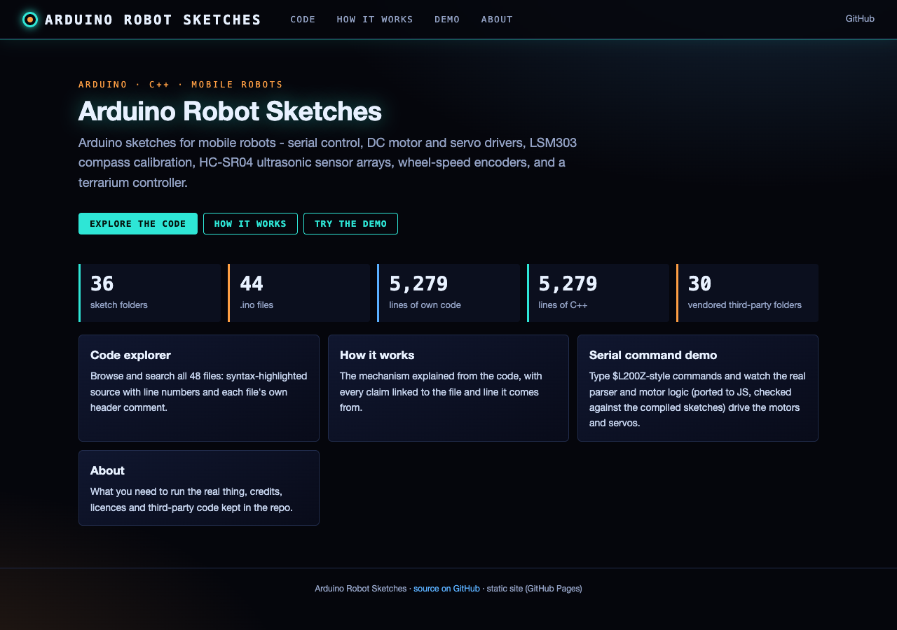
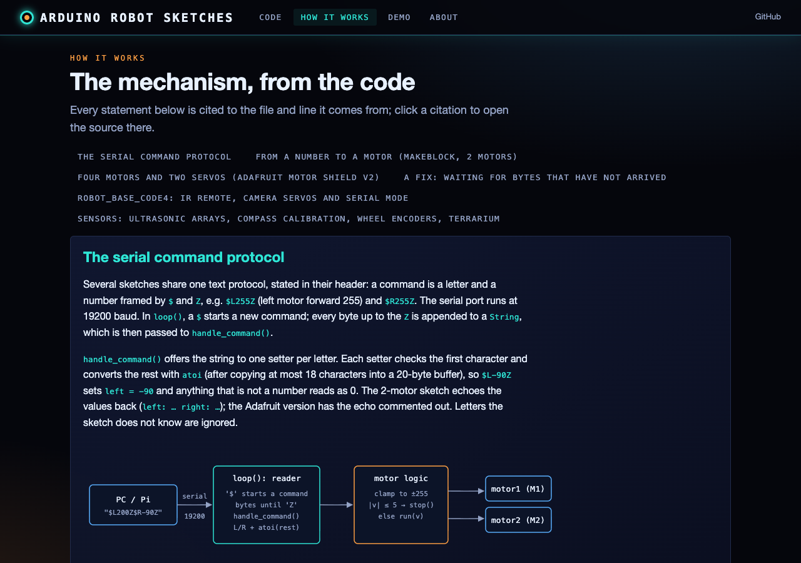
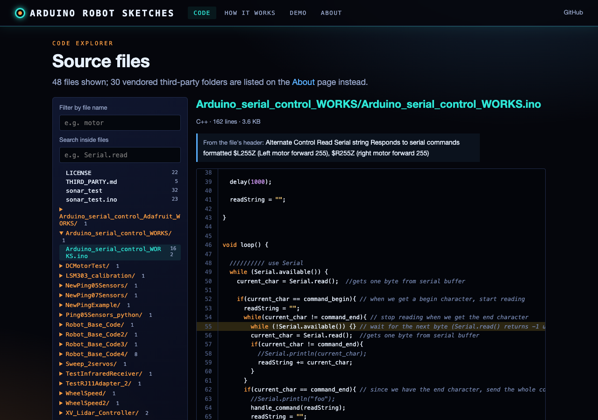
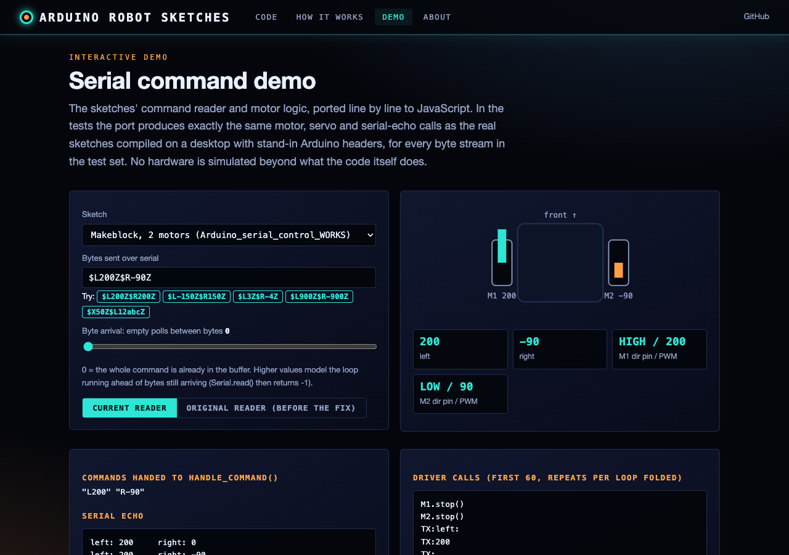

# Arduino robot sketches

Arduino sketches for mobile robots - serial control, DC motor and servo drivers, LSM303 compass calibration, HC-SR04
ultrasonic sensor arrays, wheel-speed encoders, and a terrarium controller. Each folder is one sketch for the Arduino
IDE; `libraries/` holds the third-party libraries they use (each under its own licence, see `THIRD_PARTY.md`).

The serial-control sketches (`Arduino_serial_control_WORKS`, `Arduino_serial_control_Adafruit_WORKS`,
`Robot_Base_Code4`, `piRobot_motorControl`, `drawingRobot_motorControl`, `test_2`) take commands such as `$L200Z`
(left motor 200) and `$R-90Z` (right motor reverse 90) at 19200 baud; the ROS nodes in
[robot_code](https://github.com/gddickinson/robot_code) send them.

## Web interface

A showcase site with a code explorer (syntax-highlighted source, search, each file's own header comment), a "How it
works" page whose every statement links to the file and line it comes from, a list of the vendored libraries with the
licence each states, and an interactive **serial command demo**: the command reader and motor/servo logic of the two
serial-control sketches ported to JavaScript and checked, call for call, against the real sketches compiled on a
desktop with stand-in Arduino headers (`tests/arduino_harness`).

`pip install -r requirements-web.txt && python run_web.py` (http://127.0.0.1:8258). `python scripts/build_static.py`
builds the GitHub Pages copy (published by `.github/workflows/pages.yml` on push to `master`).

| Home | How it works | Source viewer | Serial demo |
|---|---|---|---|
|  |  |  |  |

Tests: `python -m pytest -q tests` (web API, static build, citation checks, and the sketches compiled and run on the
desktop; needs a C++ compiler) and `node web/static/serial_engine.test.mjs`.

## Licence

MIT for the sketches (see `LICENSE`); libraries under `libraries/` keep their own licences (`THIRD_PARTY.md`).
